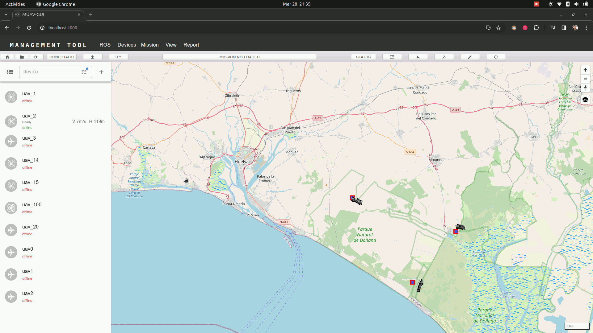
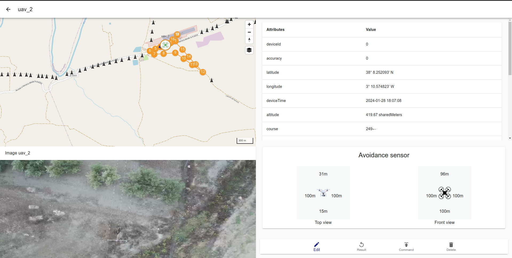

# MultiUAV-GUI

[](https://github.com/alvcaballero/multiuav_gui/releases) [](https://doi.org/10.1109/ICUAS60882.2024.10556987)

A GCS for multi UAV & long range inspection

This repository prvides an GCS software that allow command and monitoring multiple UAVs for a heterogeneous fleet of unmannned Aerial Vehicles (UAVs).
This project is part of [Multi Project](https://github.com/alvcaballero/multiUAV_system)



#### Table of Contents

- [Getting started](#getting-started)
- [Features](#-features)
- [Documentation](#documentation)
- [Future Work](#future-work)
- [Releases](#releases)

## Getting started

Requirements: Node 20 (`nvm use` reads each folder's `.nvmrc`), npm and Docker.

```bash
git clone --recursive https://github.com/alvcaballero/multiuav_gui.git
cd multiuav_gui
bash infra/setup.sh                 # server/.env, Docker images, submodules

# in two terminals, from the repo root:
cd server && nvm use && npm install && npm run server    # backend on http://localhost:4000
cd client && nvm use && npm install && npm run start     # dev frontend on http://localhost:3000
```

Or both at once: `tmuxinator start -p infra/tmuxinator/gcs-simple.yml`.

Devices are created from the web interface (they live in the database, not in a config file).

Everything else (ROS bridge, planner, MCP, video, offline map, Docker compose and tmuxinator profiles) is in
**[infra/README.md](infra/README.md)**.

## 📋 Features

- [x] **Multi-robot**: Allow monitoring and control multiple robot at same time or individual.

- [x] **Heterogeneity**: Each vehicle can possess distinct capabilities, including various velocities and battery requirements (maximum time of flight).

- [x] **Multi-User**: Interact with the web application to monitoring and control de robot fleet or a single robot can be access athrough internet or in local network.

- [x] **Third-party sotfware**: Interact with other software thought API like abstraction layer for big proyects.

- [x] **ROS easy integration**: Easy integration with diferents robot using ROS

- [x] **Mission Planning**: Allow create waypoint mission in the web interface and export in diferets formats.

- [x] **Mission Planning**: Allow create waypoint mission in the web interface and export in diferets formats.

- [x] **Video Straming from robot**: Actually allow integration to mavlink through ros packages mavros, in future use directly mavlink.

- [ ] **Mavlink integration**: Actually allow integration to mavlink through ros packages mavros, in future use directly mavlink.



The web interface use [openStreatMaps](https://tile.openstreetmap.org/) and for elevation profile use [OpentopoData](https://www.opentopodata.org/)

## Documentation

you can see the documentacion for integration in [Documentation HERE](https://arpoma16.github.io/multiuav_gui_doc/)

additional docs

1. [Install and run the GCS](infra/README.md)
1. [ROS 1 workspace for the bridge](infra/guides/ros1-workspace.md)
1. [simulation PX4 Vtool](infra/guides/sitl-px4.md)
1. [UAV camera Stream](infra/guides/camera-stream.md)
1. [Offline map](infra/guides/offline-map.md)
1. [Video streaming (WebRTC)](docs/reference/video-streaming.md)
1. [File transfer](docs/reference/file-transfer.md)

## Future Work

- Implement option to exchange ROS messages over the network,s messages using Flatbuffers without Ros on server like robofleet
- access control
- Data Bases model for maintain the information.

## Releases

### Last

- integration with external plannig

### Tag V1.4 (Download images form UAV)

### Tag V1.3

Test and Setup for Muav on Proyect Omicron Demo in Plaza de Agua

- Group points and move all route , in edit mission
- streaming of video using Websockets in MVS Architecture
- Donwload mission in diferentes file format

### Tag V1.2

- Calcule middle point for create a new mission

### Tag V1.1

- Creation mission page for eddit mission

## References and interesting project to help in develop

- [inspector software_UAV](https://github.com/AlejandroCastillejo/inspector_software_uav) in this project files from the camera are held via ftp and stored in the drone's backpack and then sent to the gcs via bashpass using and scp, this is done directly on the drone.

- [autonomus landing](https://github.com/MikeS96/autonomous_landing_uav/blob/master/Usage.md)

- [Robot Fleet](https://github.com/ut-amrl/robofleet) Open Source Communication and Management for Fleets of Autonomous Robots To exchange ROS messages over the network,s messages using Flatbuffers.

- [DJI ROS OSDK](https://github.com/miggilcas/Onboard-SDK-ROS) custom DJI ROS SDK package with all sensors avoidance and download camera images.

- [UAL](https://github.com/grvcTeam/grvc-ual) ROS UAV abstraction layer

- [altitude sensor](https://github.com/AlejandroCastillejo/sf11_altitude_sensor)

- [ROS_RTSP](https://github.com/CircusMonkey/ros_rtsp) publish video for robot to server

- [Mediamtx](https://github.com/bluenviron/mediamtx) Server multimedia for streaming video in server part

- [traccar-web](https://github.com/traccar/traccar-web) Vehicle fleet management, our interface is based in the interface of this project, and using elements of this.

## Citation

If you find UAL useful in your research, please consider citing:

```
@inproceedings{poma2024Icuas,
  title={Open-Source Web-Based Ground Control Station for Long-Range Inspection with Multiple UAV s},
  author={Poma, Alvaro Ramiro and Caballero, Alvaro and Maza, Ivan and Ollero, Anibal},
  booktitle={2024 International Conference on Unmanned Aircraft Systems (ICUAS)},
  pages={1385--1392},
  year={2024},
  organization={IEEE}
}

```
